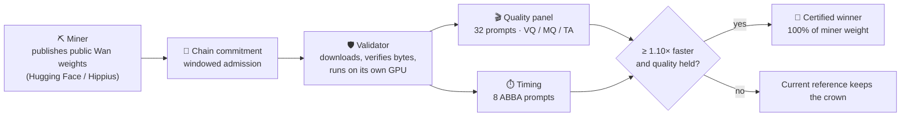

<a id="readme-top"></a>

<p align="center">
  <a href="https://attelier.ai"></a>
</p>

<h1 align="center">Attelier Subnet · forge</h1>

<p align="center">
  <b>The open competition for faster video generation.</b><br/>
  <i>Publish public weights, make Wan2.1 faster without losing quality, take the crown.</i>
</p>

<p align="center">
  <a href="https://bittensor.com"></a>
  <a href="docs/LAUNCH_V2.md"></a>
  <a href="docs/TESTNET.md"></a>
  <a href="pyproject.toml"></a>
</p>

<p align="center">
  <a href="https://attelier.ai"></a>
  <a href="https://dashboard.attelier.ai"></a>
  <a href="https://docs.attelier.ai"></a>
  <a href="https://x.com/attelier_ai"></a>
</p>

<p align="center">
  <a href="docs/miner.md"></a>
  &nbsp;
  <a href="docs/validator.md"></a>
</p>

---

<details>
<summary><b>Contents</b></summary>

- [What is forge](#what-is-forge)
- [Current status](#current-status)
- [How it works](#how-it-works)
- [The rule at a glance](#the-rule-at-a-glance)
- [Documentation](#documentation)
- [Install and check](#install-and-check)
- [Simulation and chain adapter](#simulation-and-chain-adapter)
- [Modules](#modules)
- [Automatic evaluation and the dashboard](#automatic-evaluation-and-the-dashboard)
- [Links](#links)

</details>

> [!IMPORTANT]
> The supported deployment is **testnet only**. Real evaluator qualification,
> fresh GPU/testnet acceptance and finalized reward readback are separate gates;
> integration tests do not satisfy them. **No rewards are activated by a local PASS.**
> Creator rewards remain outside this release.

<!-- WHAT -->
## What is forge

**forge** is the core of the Attelier subnet: public model optimization for
**Wan2.1-T2V-1.3B**. Miners publish immutable weights on Hugging Face or Hippius;
validators download, verify and execute them on their own GPU. The latest
certified winner receives **100%** of allocated miner weight.

The competition prioritizes **faster generation while preserving quality**. It
includes public artifact admission, a real Wan runtime, measurement receipts and a
fail-closed comparison gate. Signed distributed reports, evidence replay,
certificates and winner-takes-all weight intents are implemented. A real accepted
run through the V2 path and finalized chain publication remain necessary before
activating rewards.

An admitted artifact must be anonymously readable and carry the protocol's license
signal; public access is neither a legal-rights determination nor a promise of
permanent retention.

<p align="right">(<a href="#readme-top">back to top</a>)</p>

---

## Current status

**Optimization** uses the current bounded [Launch V2](docs/LAUNCH_V2.md) testnet
contract: 32 prompts across four families, eight paired timings and explicit
evaluator qualification. It is not a live reward activation.

**Inference on SN126** is a separate, private and permissioned mechanism-0
prelaunch rehearsal. Its only current reward calculation is an offline 24-hour
ledger simulation marked `simulationOnly`; it has no signer, no chain write and
no weight publication. Start with [Inference prelaunch](docs/INFERENCE_PRELAUNCH.md).
Inference is not an active second mechanism alongside Optimization V2.

[V1](docs/LAUNCH_V1.md) and the 16/128/32 MVP route are historical replay
documents, not current operating rules.

<p align="right">(<a href="#readme-top">back to top</a>)</p>

---

<!-- HOW -->
## How it works



<table>
<tr>
<td align="center" width="25%"><b>1 · Publish</b><br/><sub>Immutable public weights plus a bound generation recipe</sub></td>
<td align="center" width="25%"><b>2 · Verify</b><br/><sub>Snapshot, manifest, tensor bytes and license signal</sub></td>
<td align="center" width="25%"><b>3 · Measure</b><br/><sub>Quality panel, paired timing and three-seed diversity controls</sub></td>
<td align="center" width="25%"><b>4 · Crown</b><br/><sub>Signed reports, certificate and winner-takes-all weight intent</sub></td>
</tr>
</table>

<p align="right">(<a href="#readme-top">back to top</a>)</p>

---

<!-- RULE -->
## The rule at a glance

The current bounded implementation is [launch V2](docs/LAUNCH_V2.md), following
[the model competition contract](docs/MODEL_COMPETITION.md).

| | Launch V2 |
| --- | --- |
| **Base model** | Public, reusable Wan2.1-T2V-1.3B derivatives |
| **Admission** | Windowed, from finalized chain commitments |
| **Quality panel** | 32 prompts: 8 static and 24 motion across human, animal, object and scenery; separate VQ / MQ / TA checks |
| **Timing** | 8 ABBA prompts; one-sided 95% lower speed ratio **≥ 1.10** |
| **Diversity** | Three-seed controls |
| **Evaluator** | Automatically qualified, no human labeling |
| **Reward** | Latest certified winner takes **100%** of miner weight |
| **Deployment** | Testnet only |

[V1](docs/LAUNCH_V1.md), the [older MVP](docs/WAN_MVP.md) and the
[evaluator study](docs/EVALUATOR_STUDY.md) retain historical results and replay
contracts.

<p align="right">(<a href="#readme-top">back to top</a>)</p>

---

<!-- DOCS -->
## Documentation

| | Guide | What it owns |
| :---: | --- | --- |
| ⛏️ | [**Miner guide**](docs/miner.md) | Preparing and submitting immutable public weights and a bound generation recipe |
| 🛡️ | [**Validator guide**](docs/validator.md) | Execution, evidence replay and the remaining competitive activation gates |
| 📦 | [Artifacts](docs/ARTIFACTS.md) | Authoritative for snapshots, manifests, byte verification and license signals |
| 📜 | [Launch V2](docs/LAUNCH_V2.md) | The provisional model-only launch, public prompt generator and post-close entropy |
| 🎯 | [Model competition](docs/MODEL_COMPETITION.md) | The agreed target |
| 🌐 | [Distributed evaluation](docs/DISTRIBUTED_EVALUATION.md) | Chain-derived equal assignments, signed partial measurements, multi-challenger commit/reveal and the diagnostic vs. competitive paths |
| 🧪 | [Testnet](docs/TESTNET.md) | What a signed local evaluation record does and does not prove |
| ✍️ | [Qualified publication](docs/QUALIFIED_TESTNET_PUBLICATION.md) | The durable testnet-only signer protocol; not an activation |
| 📊 | [Dashboard API](docs/DASHBOARD_API.md) | Schemas, exporter and ingestion API for the [dashboard repo](https://github.com/attelierai/attelier_subnet_dashboard); not a live validator authority |
| 🔬 | [Inference prelaunch](docs/INFERENCE_PRELAUNCH.md) | Private, permissioned SN126 mechanism-0 rehearsal: unsigned 24-hour simulation only, with no chain writes or weights |
| 🔍 | [Inference boundaries](docs/INFERENCE.md) | Provider admission, gateway and trace-research boundaries; historical M1 material remains non-operative |
| 🧪 | [Evaluator study](docs/EVALUATOR_STUDY.md) | Historical evaluator research; preparation does not authorize spending |

<details>
<summary><b>Historical and diagnostic docs</b></summary>

- [`docs/WAN_MVP.md`](docs/WAN_MVP.md) retains the historical calibrated evaluator,
  receipt formats and measured diagnostics, including the
  [public LoRA run](docs/WAN_MVP.md#public-longcat-lora-diagnostic-2026-10-07),
  backup incident and remaining launch gates.
- [`docs/PROMPT_PACKS.md`](docs/PROMPT_PACKS.md) documents the older sealed-pack
  path for historical replay.
- [`docs/EVALUATOR_PILOT.md`](docs/EVALUATOR_PILOT.md) retains the historical
  development pilot and its evidence.
- [`docs/DESIGN.md`](docs/DESIGN.md) retains the older v0.2 design for historical context.

</details>

<p align="right">(<a href="#readme-top">back to top</a>)</p>

---

<!-- INSTALL -->
## Install and check

```bash
uv venv --python 3.12 .venv
uv pip install --python .venv/bin/python -e '.[dev,chain,vision]'
.venv/bin/python -m pytest -q
.venv/bin/ruff check .
```

Run `.venv/bin/forge --help` for public artifact, panel, GPU and chain commands.
Heavy artifacts belong on a remote GPU volume, not in this checkout.

<p align="right">(<a href="#readme-top">back to top</a>)</p>

---

<!-- SIM -->
## Simulation and chain adapter

```bash
.venv/bin/forge demo --out runs/demo
.venv/bin/forge chain-status --netuid <N>
.venv/bin/forge testnet-round --netuid <N> --wallet <w> --hotkey <validator>
```

> [!NOTE]
> The demo uses HMAC fakes and synthetic scores. `testnet-round` uses real finalized
> chain reads and sr25519 certificates but **simulated models**; it never submits
> weights and can emit only a local simulated diagnostic plan. Neither command
> proves real video quality.

Re-running the demo reuses SQLite state without duplicating crowns. The
`public-round-plan` command reads public-model commitments at a finalized close
block and resolves manifests; it prepares evaluation, not a reward transaction.
The legacy `miner-commit` command is explicitly for simulation.

<details>
<summary><b>Testnet records (netuid 578)</b></summary>

On testnet netuid 578, a model commitment was observed at block **8,143,985**, a
sealed-pack commitment at **8,143,991**, and the recorded close is **8,143,998**.
A signed development evaluation was anchored at **8,145,097**: 12 steps measured
1.2620x faster than 16, but quality remains uncertified and the 32-source control
campaign with the historical v2 evaluator failed temporal-order sensitivity
(19/32 shuffle detections). These are public diagnostic records, not a certified
winner, a quorum certificate, a crown or a weight update.
[`docs/TESTNET.md`](docs/TESTNET.md) owns the operational meaning of those records.

The historical follow-up v3 evaluator averages blinded orders and includes secret
adjacent-frame transitions. Its constructed-motion diagnostic passes, but it has no
approved Wan calibration. Cross-round prompt-history verification, certificates
binding the commit/reveal reports and competitive distributed replay are
implemented. Integration tests use synthetic measurements; they do not establish
real Wan quality preservation. Its calibration requirements belong to that
historical path. V2 instead requires the complete provisional rule and real
operational acceptance described in the [validator guide](docs/validator.md) and
[launch contract](docs/LAUNCH_V2.md).

</details>

<p align="right">(<a href="#readme-top">back to top</a>)</p>

---

<!-- MODULES -->
## Modules

| Package | Responsibility |
| --- | --- |
| `forge.protocol` | Contracts, sealed panels, signed reports, consensus, certificates and winner state |
| `forge.validator` | Admission, FIFO queue, budgets, GPU orchestration, evidence replay and dashboard delivery |
| `forge.evaluation` | V2 evaluator qualification, quality controls and paired timing; historical evaluator adapters remain replay-only |
| `forge.models` | Public artifacts, tensor verification, clean Wan loading and metric assets |
| `forge.chain` | Finalized chain reads, commitment transport and explicit testnet operations |
| `forge.cli` | Miner and validator command entry points |

<p align="right">(<a href="#readme-top">back to top</a>)</p>

---

<!-- EVAL + DASHBOARD -->
## Automatic evaluation and the dashboard

V2 requires its replayable qualification package, frame controls and paired ABBA
timing without human labeling. It does not require a named external judge;
historical Luna-based material remains in the MVP replay path. Calibration and
statistical power remain explicit gates; a diagnostic pilot cannot crown a winner.

<p align="center">
  <a href="https://dashboard.attelier.ai"></a>
</p>

The [subnet dashboard](https://github.com/attelierai/attelier_subnet_dashboard) uses
the pinned Studio brand and a sanitized, dated development snapshot. It shows
measured speed and unresolved quality gates, with no certified winner. The public
page serves a dated evidence snapshot and accepts signed validator reports through
its API. Workers can persist failed deliveries in an outbox for retry. Report
ingestion alone does not certify a king or activate chain weights. Local preview
and build commands do not publish updates.

<p align="right">(<a href="#readme-top">back to top</a>)</p>

---

<!-- LINKS -->
## Links

<p align="center">
  <a href="https://attelier.ai"></a>
  <a href="https://app.attelier.ai"></a>
  <a href="https://docs.attelier.ai"></a>
  <br/>
  <a href="https://x.com/attelier_ai"></a>
  <a href="https://github.com/attelierai"></a>
</p>

---

<p align="center">
  <a href="https://attelier.ai"></a>
</p>

<p align="center">
  <sub><b>Every frame optimized.</b> Built on <a href="https://bittensor.com">Bittensor</a> · Subnet 126</sub>
</p>
