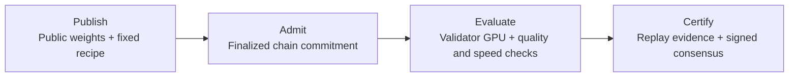

<a id="readme-top"></a>

<p align="center">
  <a href="https://attelier.ai"></a>
</p>

<h1 align="center">Attelier Subnet</h1>

<p align="center">
  <b>Open model optimization for faster video generation.</b><br/>
  Improve Wan2.1. Publish reproducible weights. Compete on measured speed and quality.
</p>

<p align="center">
  <a href="https://bittensor.com"></a>
  <a href="docs/LAUNCH_V2.md"></a>
  <a href="docs/TESTNET.md"></a>
  <a href="pyproject.toml"></a>
</p>

<p align="center">
  <a href="https://attelier.ai">Website</a> ·
  <a href="https://dashboard.attelier.ai">Dashboard</a> ·
  <a href="https://docs.attelier.ai">Docs</a> ·
  <a href="https://x.com/attelier_ai">X</a>
</p>

<p align="center">
  <a href="docs/miner.md"></a>
  &nbsp;
  <a href="docs/validator.md"></a>
</p>

---

## What is Attelier Subnet?

Attelier Subnet is a model optimization competition for **Bittensor SN126**,
starting with **Wan2.1-T2V-1.3B** text-to-video generation. The goal is to make
video generation faster while meeting explicit quality requirements.

Miners publish public model weights and a fixed generation recipe. Validators
download those weights, verify them and generate videos on their own GPUs.
Each candidate is measured against the current reference for speed and against
both that reference and the original Wan model for quality.

Published models can be downloaded and improved by other participants, so each
result can become a starting point for the next. The reward rule assigns
**100% of the allocated miner weight to the latest certified winner**, once
the separate chain publication requirements are met.

**Explore:** [Status](#current-status) · [How it works](#how-it-works) ·
[Competition rules](#competition-rules) · [Get started](#get-started) ·
[Documentation](#documentation)

## Current status

The supported optimization deployment is **testnet only**, under the
[Launch V2 contract](docs/LAUNCH_V2.md). Its configured testnet is **netuid 578**;
SN126 identifies the Attelier subnet, not the testnet network to use in commands.

> [!IMPORTANT]
> A local evaluation pass does not activate rewards. Evaluator qualification,
> real GPU/testnet acceptance, signed consensus and finalized on-chain weight
> verification are separate requirements. Passing code tests or simulations
> does not satisfy them.

Inference on SN126 is a separate, private, permissioned prelaunch rehearsal.
It currently uses an unsigned, offline 24-hour reward simulation with no chain
writes or weight publication. It is not a second active mechanism alongside
optimization. See [Inference prelaunch](docs/INFERENCE_PRELAUNCH.md).
Creator rewards are outside this release.

## How it works



1. **Publish a candidate.** Upload an immutable model revision to Hugging Face
   or Hippius, with its manifest, generation recipe and required license metadata.
   Supported artifacts are a compatible LoRA or a full transformer.
2. **Enter an admission window.** Commit the candidate identity on-chain.
   The round freezes the model, recipe and configuration before deriving its
   evaluation prompts and seeds.
3. **Measure independently.** Validators verify the published bytes and run
   the candidate on their own GPUs. They measure quality, paired generation
   times and output diversity using a qualified evaluator.
4. **Certify the result.** Validators replay the evidence and reach signed
   consensus. A local pass is eligible for promotion; changing effective reward
   weights still requires qualified publication and finalized chain verification.

Miners submit weights and a recipe; validators produce the evaluation videos
and measurements. Failed or inconclusive comparisons retain the current reference.

## Competition rules

The [Launch V2 contract](docs/LAUNCH_V2.md) defines the current rules, exact
thresholds and evidence requirements.

| Requirement | Current rule |
| --- | --- |
| **Model** | Wan2.1-T2V-1.3B with a compatible LoRA or full transformer and an approved generation recipe |
| **Public artifacts** | Immutable, anonymously downloadable weights on Hugging Face or Hippius, with verified bytes and the required license signal |
| **Admission** | Finalized chain commitments; one candidate per hotkey lineage per window, with no concurrent pending submission |
| **Quality panel** | 32 prompts: 8 static and 24 motion, across human, animal, object and scenery families |
| **Quality checks** | Separate visual quality (VQ), motion quality (MQ) and text alignment (TA) checks against the current reference and original Wan-50 anchor |
| **Speed** | 8 paired ABBA timing prompts; the one-sided 95% lower confidence bound of the speed ratio must be **at least 1.10×** |
| **Diversity** | 4 prompts with 3 seeds each; identical decoded videos across seeds are rejected |
| **Evaluator** | Replayable automatic qualification and frame controls; no human quality labeling required |
| **Reward allocation** | Latest certified winner receives **100% of allocated miner weight**, subject to chain publication and verification |

The fixed Wan-50 quality anchor prevents small tolerated losses from accumulating
across successive winners. Quality margins are provisional evaluator-score
thresholds, not percentages of perceived quality. Artifact access and license
checks are defined in [Public artifact admission](docs/ARTIFACTS.md).

## Get started

| Your role | Start here |
| --- | --- |
| **Miner** | [Prepare, verify and submit a model](docs/miner.md) |
| **Validator** | [Run evaluations, replay evidence and understand publication requirements](docs/validator.md) |
| **Developer** | Install the project below, then read the [Launch V2 contract](docs/LAUNCH_V2.md) |
| **Observer** | Explore the [dashboard](https://dashboard.attelier.ai) and [testnet evidence](docs/TESTNET.md) |

### Local development

Use **Python 3.12** and [uv](https://docs.astral.sh/uv/):

```bash
git clone https://github.com/attelierai/attelier_subnet.git
cd attelier_subnet

uv venv --python 3.12 .venv
uv pip install --python .venv/bin/python -e '.[dev,chain,vision]'
.venv/bin/python -m pytest -q
.venv/bin/ruff check .
```

This installs the development environment and runs the code checks. GPU runtime
setup and operational commands are covered in the miner and validator guides.
Keep model weights, datasets and generated videos on remote GPU storage, outside
this checkout.

### Repository layout

| Directory | Contents |
| --- | --- |
| [`src/`](src/) | Protocol, artifact handling, evaluation, validator services, chain integration and CLI |
| [`configs/`](configs/) | Versioned contracts, launch configuration and model manifests |
| [`docs/`](docs/) | Participation guides, protocol rules and recorded evidence |
| [`tests/`](tests/) | Unit and integration checks |
| [`scripts/`](scripts/) | Evaluation, research and operational utilities |
| [`ops/`](ops/) | Service and timer definitions |

## Documentation

| Guide | Covers |
| --- | --- |
| [Launch V2](docs/LAUNCH_V2.md) | Current testnet rules, evaluator qualification, timing, quality and publication requirements |
| [Public artifact admission](docs/ARTIFACTS.md) | Model compatibility, manifests, immutable revisions, byte verification and license signals |
| [Distributed evaluation](docs/DISTRIBUTED_EVALUATION.md) | Validator assignments, signed reports, evidence replay and consensus |
| [Testnet](docs/TESTNET.md) | Recorded experiments, operational commands and the limits of diagnostic evidence |
| [Qualified publication](docs/QUALIFIED_TESTNET_PUBLICATION.md) | Testnet signing, submission recovery and finalized weight verification |
| [Dashboard API](docs/DASHBOARD_API.md) | Signed report ingestion, snapshots and delivery retries |
| [Inference prelaunch](docs/INFERENCE_PRELAUNCH.md) | Separate SN126 inference rehearsal and offline reward simulation |
| [Inference boundaries](docs/INFERENCE.md) | Provider admission, gateway integration and trace research |

The [dashboard](https://dashboard.attelier.ai) presents recorded measurements and
evaluation status. Check the date and evidence attached to each result:
displaying a report does not certify a winner or activate on-chain rewards.

<details>
<summary><b>Historical designs and experiments</b></summary>

These documents preserve earlier designs and reproducible evidence. Use Launch V2
and the current participation guides for operating instructions.

- [Model competition target](docs/MODEL_COMPETITION.md): design goals and the earlier V1 activation plan.
- [Launch V1](docs/LAUNCH_V1.md): previous launch contract.
- [Wan MVP](docs/WAN_MVP.md): earlier evaluation path, measurements and diagnostic runs.
- [Prompt packs](docs/PROMPT_PACKS.md): historical sealed-pack format.
- [Evaluator study](docs/EVALUATOR_STUDY.md) and [pilot](docs/EVALUATOR_PILOT.md): evaluation research and recorded experiments.
- [Original design](docs/DESIGN.md): v0.2 architecture.

</details>

---

<p align="center">
  <a href="https://attelier.ai"></a>
</p>

<p align="center">
  <b>Every frame optimized.</b><br/>
  Built on <a href="https://bittensor.com">Bittensor</a> · Subnet 126<br/>
  <a href="https://attelier.ai">Website</a> ·
  <a href="https://app.attelier.ai">App</a> ·
  <a href="https://dashboard.attelier.ai">Dashboard</a> ·
  <a href="https://x.com/attelier_ai">X</a> ·
  <a href="https://github.com/attelierai">GitHub</a>
</p>

<p align="right"><a href="#readme-top">Back to top ↑</a></p>
