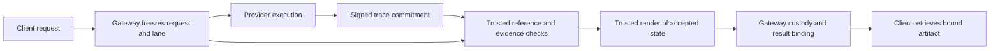

# Auditing Video Inference with Committed Execution Traces and Trusted Rendering

**Attelier · Technical research draft · 26 October 2026**

## Abstract

A video inference provider can return a plausible file without establishing that it satisfies the requested execution contract. Media inspection can check duration, resolution and perceptual quality, but cannot identify the computation behind the result. A signed receipt authenticates a claim without making the claim true. Execution evidence also remains insufficient if a different video reaches the client.

We describe an experimental audit protocol that connects a request to a committed execution trace, compares that trace against a trusted implementation, and renders the accepted terminal state into the delivered media. Its central object is the complete relationship between request, execution evidence and delivered bytes. The protocol separates authenticated evidence, numerical consistency, result custody and service performance. It returns `verified`, `invalid` or `inconclusive`, with faults attributed only where the evidence supports attribution.

The concrete candidate targets a restricted H3 video-and-audio profile with 20 model calls. It uses a complete trusted reference execution and a trusted renderer. This is an operator-trusted consistency check, not a succinct cryptographic proof, hardware attestation or proof of who physically performed the work. The available qualification campaign is incomplete. We specify the acceptance experiment, the costs that must be measured, and the conditions under which selective auditing could be investigated. The main unresolved question is whether the assurance obtained justifies the additional compute, data movement and delivery latency relative to trusted generation alone.

## 1. The verification problem

Video inference combines expensive model evaluation with a delivery pipeline. A request may specify a checkpoint, conditioning inputs, seed, sampler, resolution, duration, audio and numerical execution policy. The customer ultimately receives a compressed file, often after several transformations. Verifying one intermediate object does not automatically verify this entire path.

The distinction matters when independent providers receive work and rewards. A provider could use an unapproved cheaper model, shorten an execution schedule, reuse an old result, alter intermediate states or attach a different file to otherwise valid evidence. Infrastructure can also fail without provider misconduct: a verifier may be unavailable, a transfer may be incomplete, or an honest runtime may fall outside a supported numerical profile.

Three questions therefore need separate answers:

| Question | Evidence required | What that evidence does not establish |
| --- | --- | --- |
| Was the service delivered? | Accessible, decodable media satisfying the format contract, with measured time to availability | Which computation produced it |
| Is the submitted execution evidence consistent with the contracted computation? | Request binding, trusted model evaluation, state-transition checks and terminal-state binding | Physical GPU ownership or exclusive execution by the named provider |
| Is the result useful? | Quality and instruction-following evaluation appropriate to the use case | Execution of a particular checkpoint or schedule |

Video quality benchmarks address the third question. VBench, for example, evaluates multiple aspects of generation quality and condition consistency. Those observations are useful alongside execution auditing, but do not identify a unique generating computation; that distinction is our interpretation of their scope. [VBench](https://vchitect.github.io/VBench-project/)

This paper addresses the second question and its connection to the first. It proposes a protocol boundary, a concrete reference candidate and an evaluation design. It does not claim a new cryptographic primitive or established superiority over alternative verification systems.

## 2. Actors, profiles and trust

### 2.1. Actors

The **client** supplies a request and receives media. The **gateway** admits the request, records its immutable dispatch context, coordinates custody and exposes the result. The **provider** performs work and commits evidence. The **verifier** checks the evidence using an approved reference implementation. The **trusted renderer** converts the accepted terminal state into media under a pinned rendering contract.

These are logical roles. Separating their processes or machines can help test boundaries, but does not by itself establish independent ownership, independent governance or resistance to collusion. In the initial design, the gateway, qualification registry, verifier and renderer remain within an operator-controlled trust boundary.

### 2.2. A profile is more than a model name

A profile identifies the computation and output contract. It binds model artifacts, conditioning components, numerical settings, sampler and schedule, required evidence, rendering pipeline and supported output parameters. Its digest changes when a bound component changes.

The execution can be written abstractly as:

$$
c = C_P(u), \qquad z_0 = I_P(s,u),
$$

$$
a_t = A_P(z_t,c,t), \qquad y_t = F_{\theta,P}(a_t),
$$

$$
z_{t+1} = U_P(z_t,y_t,c,t), \qquad v = R_P(z_T).
\tag{1}
$$

Here, $P$ is the frozen profile; $u$ contains the request inputs; $s$ is the effective seed; $C_P$ constructs conditioning; and $I_P$ constructs the initial state. The state $z_t$ includes any sampler history needed by the next update, rather than only the current latent. $A_P$ constructs actual model arguments, $F_{\theta,P}$ evaluates the approved model, $U_P$ updates the state, and $R_P$ produces the delivery artifact.

For a model with audio, the state and rendering contract include the relevant audio components. For a general generator, a sampler step can involve multiple model calls. A profile must enumerate the required calls and transitions instead of assuming that a progress counter is a faithful count of model computation.

Equation (1) is an explanatory abstraction. An implementation must bind its concrete callback timing, tensor layout, conditioning and history to this abstraction. A callback labelled “step 7” is not sufficient evidence of the seventh required forward computation.

### 2.3. Qualification is attached to an exact lane

The candidate associates qualification with:

`provider identity, worker identity, profile ID, profile digest, renderer digest`

A qualification also has evidence provenance, an expiry and a policy version. A worker's self-description cannot issue its own qualification. Changing the relevant identity, runtime, profile or renderer requires review of the changed binding; historical measurements do not silently transfer.

Runtime and artifact hashes help identify the intended software. Without a hardware-rooted measurement and an appropriate workload trust policy, they remain operator measurements rather than remote hardware attestation.

## 3. Threat model

We consider a provider that can control its software, claimed timings, submitted tensors, metadata and proposed media. It can observe its request, retain earlier evidence, coordinate with other providers and choose when to submit. The gateway and verifier may encounter delays, partial transfers, restarts and unsupported environments.

The audit assumes that the trusted implementation, its approved model artifacts, renderer, identity registry and retained request context are correct and remain under the intended control. It also assumes the usual integrity properties of the selected hash and signature schemes. A compromised reference implementation or a colluding verifier is outside the protection of the initial architecture.

| Threat | Required check | Remaining limit |
| --- | --- | --- |
| Earlier evidence attached to a new request | Request digest, nonce, seed policy, lane identity and freshness | A new receipt can still describe honestly outsourced work |
| Different conditioning, model arguments or initial noise | Reconstruct them from trusted request inputs and compare bound evidence | Metadata naming a checkpoint is insufficient |
| Omitted calls or shortened schedule | Complete invocation and schedule coverage, with model evaluation and transition checks | A callback count alone is insufficient |
| Fabricated but internally consistent trajectory | Evaluate the approved model, not only the recurrence | A self-consistent fake trajectory can pass a recurrence-only test |
| Altered terminal video or audio state | Bind terminal components to the accepted trajectory and signed manifest | Partial component coverage leaves a gap |
| Substituted provider MP4 | Deliver only the artifact produced from the accepted state by the trusted renderer | Downstream edits require their own binding |
| Evidence changed after audit selection | Record one immutable commitment before selecting checks | A signature alone does not establish when it was observed |
| Malformed or excessive evidence | Bounded parsing, authenticated transfer, size limits and safe tensor loading | Verification remains an attack surface and a resource cost |
| Unavailable verifier or interrupted transfer | Preserve uncertainty and attribution | Infrastructure failure is not proof of provider fraud |
| Operator omission or conflicting records | Independently observed commitments and reconciliation where required | An operator signature alone does not prove completeness |

The target is evidence consistent with a requested computation and a bound delivery. It is not a claim that the named provider owned a particular GPU, executed exclusively on its own hardware, or used no intermediary. A provider may obtain a completely valid trace through outsourcing. Whether outsourcing is allowed is a separate service policy.

## 4. Protocol

### 4.1. Freeze the request before dispatch

Before sending work, the gateway records a canonical request containing the job identity, a fresh verifier-controlled nonce, input and parameter bindings, the target lane and the relevant time limits. This record becomes the authority for the attempt. Later provider metadata cannot substitute a different request or worker.

The candidate distinguishes a caller's requested seed from an effective execution seed derived from the job identity, nonce, requested seed and profile digest. This binds an execution to a particular attempt. An idempotent retry retains the same attempt and therefore the same effective seed.

This seed policy has product consequences. Two new jobs with the same caller seed may have different effective seeds. A service promising exact fixed-seed reproduction must define that promise separately: it could preserve the execution seed and use a nonce solely for receipt binding, while accepting the resulting limits on fresh-computation claims. Neither policy proves that a provider has performed new physical work when it can legitimately reuse a result.

Canonical encoding must be unambiguous across implementations. The candidate uses a restricted JSON encoding with sorted keys, bounded integers and explicit representations for numerical tolerance values. The schema, encoding and signature message are versioned together. A new wire specification must not be introduced merely by changing the notation in this paper.

### 4.2. Commit execution evidence

After producing evidence, the provider submits a signed envelope binding the request, lane, profile, ordered evidence manifest and terminal-state references. For chunks $B_0,\ldots,B_{n-1}$, the commitment can be expressed as:

$$
h_j = H(B_j), \qquad
M = [(j,\operatorname{name}_j,|B_j|,h_j)]_{j=0}^{n-1},
$$

$$
h_M = H(\operatorname{Canonical}(M)).
\tag{2}
$$

The current construction is a hash of an ordered manifest, not a Merkle tree. Referring to $h_M$ as a root does not give it Merkle inclusion proofs. Every tensor and forward bundle used in verification must resolve to committed evidence; an auxiliary capture file cannot introduce unsigned dependencies.

The gateway records the commitment before any selective audit is revealed. That ordering must be supported by durable observation, not only by a provider-supplied timestamp. For a protocol allowing selective disclosure, the complete manifest remains committed and the retrieval rules are fixed in advance.

The candidate authenticates provider receipts with Ed25519. The signature authenticates the signed bytes under a pinned key; it does not establish that their assertions are true. [EdDSA specification](https://www.rfc-editor.org/rfc/rfc8032)

### 4.3. Check binding and evidence custody

Before expensive model execution, the verifier checks the signature, request digest, lane, profile, permitted time range, complete manifest and terminal references. It enforces limits on total bytes, chunk count, individual chunk size, paths, nesting and tensor shapes. Tensor loading must not execute provider-supplied code.

Retrieved chunks must match their committed sizes and hashes. A digest mismatch establishes that received bytes do not match the commitment, but assigning responsibility still requires evidence about the authenticated transfer and storage path. Missing chunks may be a provider service failure or a platform problem; neither possibility should be silently converted into a successful audit.

The verifier separately checks that the approved reference runtime and renderer match the frozen profile. An unsupported runtime is not a reason to broaden numerical tolerances during the audit.

### 4.4. Validate model computation and transitions

The reference candidate reconstructs conditioning and initial state from the trusted request and performs a complete approved execution. It compares the submitted model arguments, predictions, schedule, trajectory and terminal components with that execution. The H3 candidate uses bitwise comparisons for its required tensor and forward-payload checks, with a separately specified numerical check for sampler recurrence.

The comparison must cover actual model inputs. Checking only that $y_t$ resembles a reference output leaves room to associate it with a different $a_t$. Similarly, checking only a transition $z_t\rightarrow z_{t+1}$ does not prove that the claimed model prediction came from $F_{\theta,P}$.

A useful transition diagnostic is a relative root-mean-square residual:

$$
e_t =
\frac{\operatorname{RMS}(z_{t+1}-\widehat{U}_P(z_t,y_t,c,t))}
{\max(\operatorname{RMS}(z_{t+1}),\epsilon)},
\tag{3}
$$

evaluated on the state components for which the update is defined. The implementation must specify the norm, arithmetic, denominator floor $\epsilon$, history and terminal treatment. A nonterminal callback diagnostic does not automatically cover the initial state, final state or every model input. In the candidate, the independent reference comparisons supply additional bindings that the recurrence diagnostic alone lacks.

Once the complete trusted execution has supplied all required model comparisons, running a second identical full replay would repeat that computation without adding a new independent check. The inspected candidate avoids such a second replay. Its measured cost must nevertheless include the complete first reference execution.

### 4.5. Render the accepted terminal state

The trusted renderer consumes the accepted terminal components, not a provider-supplied MP4. It applies the approved decoders, temporal alignment, audio processing, encoding and container policy. The resulting artifact must satisfy the profile's media checks.

For the restricted H3 candidate, the requested delivery is five seconds at 24 frames per second. Internal frame alignment and final trimming are part of the renderer contract. The output is checked as a 120-frame delivery with the specified video and audio properties. The exact raster is 832 × 480; a marketing label such as “480p” cannot replace that binding.

Renderer changes can affect the delivered result even when model execution is unchanged. Its digest therefore belongs in the lane qualification and delivery receipt. The method does not require arbitrary encoders or separate rerenders on different systems to produce identical compressed bytes. It requires the client artifact to match the particular accepted renderer output recorded for that job.

### 4.6. Bind delivery and retain the outcome

Let $v$ be the trusted renderer's output and $d$ the artifact exposed to the client. The delivery relationship requires:

$$
H(d)=H(v), \qquad |d|=|v|,
\tag{4}
$$

together with successful media validation. During qualification, an independent client retrieves, hashes and decodes the delivery. Checking a file only on the verifier host does not demonstrate the API delivery path.

The result record links request, provider receipt, profile, verifier and renderer identities, checked coverage, verdict, artifact hash, size and timing evidence. Subsequent transformations, including transcoding or content modification, create new artifacts and require an explicit derived-artifact relationship. An old hash cannot certify edited bytes.

The gateway should record success only after the required custody transition is complete. Restarts must recover the same request and result binding. An uncertain provider admission is reconciled with that attempt rather than automatically dispatching a duplicate elsewhere.

**Figure 1. Proposed protocol flow.** The request is frozen before provider execution. A committed trace crosses into the trusted verification boundary. The accepted terminal state crosses into trusted rendering. The client receives the recorded renderer artifact. Provider media has no fallback path around these checks.

## 5. Verdicts and the meaning of verification

The audit has three terminal verdicts. `Pending` is an operational state while a bounded check or re-audit is outstanding, not an additional success class.

| Verdict | Meaning | Consequence for an execution-verification claim |
| --- | --- | --- |
| `Verified` | The qualified profile's required checks and delivery bindings succeeded | The exact request can carry that profile's verification claim |
| `Invalid` | Evidence establishes a specific contradiction or violation attributable to the provider | The attempt cannot earn verified-service credit; retain the reason |
| `Inconclusive` | Evidence, supported runtime, trusted execution or delivery custody is insufficient | No verified-service claim; no automatic allegation of fraud |

A numerical mismatch becomes evidence of a provider-attributed contradiction only under an applicable, frozen profile and a functioning trusted baseline. A changed or unsupported trusted runtime cannot turn an otherwise unexplained discrepancy into misconduct.

A timeout may violate a service contract without establishing incorrect model execution. Maintaining separate fields for execution verdict, service outcome and fault attribution prevents these meanings from collapsing into one “failure” counter. Persistent inconclusive outcomes can justify suspending fresh routing to a lane while preserving that distinction.

Diagnostic execution on an unqualified profile may produce useful internal measurements. It must remain visibly diagnostic and must not issue a verified delivery or promote the profile by itself.

### 5.1. Conditional consistency claim

Under the stated trust assumptions, a complete exact comparison establishes that the committed mandatory evidence agrees with the approved reference computation for the bound request. Trusted rendering and artifact binding then establish which output was delivered from the accepted terminal state.

This claim depends on complete coverage of the model inputs, required computations, transitions, terminal components and delivery path. It also depends on the reference implementation correctly representing the intended profile. A shared implementation defect can make two executions agree while violating the intended model contract.

The conclusion is a consistency and custody statement. It is not a proof of the provider's physical execution history, unique checkpoint provenance, confidentiality, artistic quality or absence of collusion. A different implementation that produces the same required evidence is not distinguishable solely through these comparisons.

For tolerant comparison, accepting each local residual does not by itself establish a global bound on final-output error. A separate propagation argument or empirical validation is needed. This paper does not supply a universal soundness bound for tolerant video inference.

## 6. Numerical profiles and optimization

Floating-point operations depend on ordering, kernels, precision and platform. PyTorch explicitly does not guarantee bitwise-identical results across releases or platforms, and mathematically equivalent batched and unbatched operations may differ. This motivates a narrowly qualified numerical profile rather than an assumption of universal equality. [PyTorch numerical accuracy](https://docs.pytorch.org/docs/2.14/notes/numerical_accuracy.html)

The H3 candidate fixes a native Blackwell execution profile, model and dependency artifacts, schedule and renderer. The required model comparisons are exact within that profile. A separately frozen tolerance applies to a specified recurrence diagnostic; it is not permission to accept arbitrary differences in model predictions.

Only explicitly enumerated, semantically irrelevant metadata may be normalized. For example, the inspected comparison permits a narrow internal cache-identifier difference. Such an exception must not remove conditioning, scheduling or tensor information and must be tested as part of the comparator contract.

Calibration must precede held-out evaluation. It should measure variation from independent honest executions under the intended profile and examine the separation from specified adversarial perturbations. Reusing a capture under another path or identifier does not create a new observation. Calibration and holdout must have disjoint generation lineages.

Optimizations expose a design tension. New kernels, quantization or distilled models may lower serving cost while changing the exact trace. Treating all such changes as eligible under an old exact profile would weaken the claim; treating every difference as malicious would block legitimate improvement. The proposed boundary is a versioned profile with explicit quality and verification acceptance. Evidence may be reused only for unchanged components where that reuse is justified, not as automatic qualification of a new computation.

## 7. Cost and the trusted-generation baseline

The strongest operational question is why to verify outsourced generation if the verifier already performs a complete generation. Full comparison may be valuable for qualification, diagnosis and attributable records, but those uses do not establish an efficient serving market.

For an audited attempt, define the incremental workflow cost as:

$$
C_{\mathrm{attempt}} = C_{\mathrm{provider}} + C_{\mathrm{capture}}
 + C_{\mathrm{transfer}} + C_{\mathrm{reference}}
 + C_{\mathrm{compare}} + C_{\mathrm{render}}
 + C_{\mathrm{storage}} + C_{\mathrm{delivery}}.
\tag{5}
$$

The terms must be measured without double counting. If capture overhead is already included in a provider's measured GPU interval, it is not added again. If a reference graph also performs rendering, that work must remain in the total even when a later render is separately timed. Failed attempts, idle reserved capacity, cold starts and bounded retries also belong in campaign cost.

The primary economic measure is:

$$
C_{\mathrm{valid}} =
\frac{\text{total cost of all attempts and allocated capacity}}
{\text{number of qualifying deliveries}}.
\tag{6}
$$

With no qualifying deliveries, the result is undefined, not zero. Report cost attribution and valuation assumptions alongside the numerator.

User-facing time to video is:

$$
T_{\mathrm{video}} = t_{\mathrm{available}}-t_{\mathrm{accepted}}.
\tag{7}
$$

It includes queueing, generation, required audit, rendering and custody on the critical path. Stage durations help explain the total, but overlapping stages cannot simply be summed as if they were sequential. Miner execution time remains a separate measurement, so verifier delays are not silently assigned to the miner.

The evaluation should compare at least three configurations using matched requests and profile requirements:

| Configuration | Purpose | Main comparison |
| --- | --- | --- |
| Trusted direct generation and delivery | Operational baseline | Cost and latency without a provider trace exchange |
| Permissioned provider with ordinary media custody | Serving baseline | Cost of outsourcing under operational trust |
| Provider plus full reference audit and trusted rendering | Verification candidate | Additional assurance, cost, trace volume and latency |

A future sampled configuration is a separate comparison with a weaker, explicitly stated coverage claim. Results should identify cache state, hardware, concurrency, sample count and failures. A successful implementation is not evidence of a cost advantage. If the full-audit configuration is dominated by trusted direct generation for the intended service, it may remain useful as a qualification tool rather than the default production path.

## 8. Selective auditing as a separate research direction

Two different sampling decisions are possible: auditing only some jobs, or checking only some model calls within an audited job. Their guarantees must not be conflated. The present candidate requires full coverage for every result carrying its verified-execution claim.

Suppose a committed execution contains $N$ auditable positions, of which $k$ contain a detectable contradiction. Selecting $m$ distinct positions uniformly after commitment gives:

$$
p_{\mathrm{detect}} = 1 -
\frac{\binom{N-k}{m}}{\binom{N}{m}}.
\tag{8}
$$

For $N=20$, $k=1$ and $m=3$, this is $0.15$. The expression assumes the contradiction is detectable when selected, all positions are available, the sample is unpredictable before commitment and the attacker cannot replace the evidence afterward. Audit randomness must not be derived solely from a generation seed or nonce already visible to the provider. It is a probability for this sampling experiment, not a general security guarantee. An attack may affect more or fewer observable positions than the number of physical operations omitted.

If a job is independently selected with probability $q$, the detection probability for that particular attacked job is $q\,p_{\mathrm{detect}}$ under the same assumptions. Checking selected predictions also requires their input and state bindings; isolated tensor checks do not establish the whole trajectory. A repeated-job analysis additionally requires justified independence and a model of adaptive behavior.

A simple incentive condition illustrates what sampling would need to achieve. If successful cheating saves $G$ and detection causes an enforceable additional loss $L$, the expected incremental benefit is:

$$
\Delta = G-q\,p_{\mathrm{detect}}L.
\tag{9}
$$

This accounting convention treats $L$ as the loss relative to an undetected cheating attempt. It assumes the gain is obtained even on detected attempts and ignores risk preferences; other settlement rules change the expression. Deterrence in this simplified model requires $q\,p_{\mathrm{detect}}L\geq G$.

No enforceable bond, slashing mechanism or quantified loss is established by this paper. Reputation is not equivalent to collateral, especially when identities are cheap to replace. Formula (9) is therefore a design constraint rather than a claim that current incentives deter fraud.

Audit timing also changes the product. Verification before release adds latency. Auditing after release may detect a problem after the client has consumed the file. Holding reward until an audit completes addresses settlement but does not retroactively make an unaudited delivery verified. Each choice needs its own disclosure, dispute handling and cost model.

## 9. Qualification experiment

### 9.1. Decision and sampling unit

The initial experiment asks whether one frozen provider–verifier configuration can support bounded qualification of its exact profile and lane. It does not decide whether arbitrary providers, GPUs or models may join.

Use separate development, calibration and held-out generation lineages. Freeze the profile, evaluator, input plan, thresholds, attack construction, verdict expectations and required custody evidence before holdout execution. Record independent generation provenance as well as unique identifiers and hashes.

A concrete initial holdout consists of three independent prompt lineages. For each lineage, include the cases below. One separate development smoke precedes the holdout and is excluded from its counts.

| Case | Cases per lineage | Total | Required outcome |
| --- | ---: | ---: | --- |
| Honest generation with distinct request and seed | 2 | 6 | Full checks and client delivery succeed |
| Skipped required model call | 1 | 3 | Contradiction is rejected under the frozen contract |
| Actual shortened execution schedule | 1 | 3 | Contradiction is rejected |
| Freshly signed altered terminal-state bundle | 1 | 3 | Contradiction is rejected |
| Valid trace paired with substituted provider media | 1 | 3 | Client receives the trusted render, never the substituted file |
| Old signed evidence attached to a fresh request | 1 | 3 | Binding failure is rejected before expensive model work |
| **Total** | **7** | **21** | **Every required outcome and custody condition is established** |

The substituted-media case is intentionally not an expected invalid trace: a valid trace may remain valid while an irrelevant provider MP4 is ignored. The test passes when the actual delivery follows the trusted rendering path.

The matrix is a minimum candidate-specific experiment, not comprehensive threat coverage. Before broader admission, add independent cases for conditioning substitution, model substitutions, evidence equivocation, malformed resources, audio-specific corruption and adverse concurrency. Each extension requires its own frozen expectations.

### 9.2. Delivery, recovery and attribution

For every accepted output, an independent client retrieves the complete artifact, checks its hash and size, probes its streams and fully decodes it. Receipts link the plan, case, request, lane, profile, provider commitment, verifier report, renderer and delivered bytes.

Repeat the delivery read after a controlled service restart, preserving the same request and result identity. The experiment must demonstrate recovery without duplicate work or a fallback to unverified provider media. Reference execution failure, unsupported runtime, unavailable evidence or missing client custody produces an incomplete or inconclusive qualification result.

Stop on a known honest false rejection, an accepted bad trace, a profile mismatch or inability to complete the required evidence within the experiment's limits. Do not tune a threshold against the observed holdout and then report that same holdout as independent validation.

### 9.3. Reporting and uncertainty

Report outcomes by attack family, honest generation lineage, runtime, numerical profile and delivery stage. Keep execution verdicts, service failures and platform-inconclusive cases separate. Include their denominators; excluding inconclusive cases from an accuracy calculation must not hide their operational frequency.

The 21 cases are not 21 independent samples: derived attacks and repeated generations share three prompt lineages. Frames, tensors and steps are also not independent experimental subjects. Completing this matrix is evidence about a bounded test suite, not a population-wide false-accept rate.

For illustration, with zero observed failures in $n$ independent, representative Bernoulli trials, a one-sided 95% upper bound is $1-0.05^{1/n}$. The assumptions do not hold merely because a report contains $n$ rows. Adaptive attacks and correlated lineages require a different interpretation, and this draft does not assign a numerical security rate to the initial matrix.

Report trace bytes, stage timings, end-to-end latency, full allocated cost, restart results and retained evidence coverage alongside correctness outcomes. Small-sample percentiles must remain descriptive rather than being promoted to a production service guarantee.

## 10. Implementation and evidence status

The inspected H3 candidate implements request and lane binding, bounded evidence validation, a complete trusted reference comparison, recurrence diagnostics and rendering from the accepted terminal state. Its restricted contract is text-to-video with audio, five seconds, 832 × 480 output, 24 fps and 20 required model calls. This implementation scope does not establish generality to other video models or arbitrary optimized runtimes.

The evidence record is intentionally limited:

| Evidence category | Recorded status | Supported interpretation |
| --- | --- | --- |
| Protocol and runtime code | Candidate exists for the restricted profile | A concrete method can be inspected; existence is not qualification |
| Local integration evidence | Historical fixture-based checks cover protocol, subprocess, transport and media boundaries | Evidence about those tested boundaries; simulated model execution is not an H3 result |
| GPU holdout campaign | The 25 October 2026 record reports 16 of 21 cases executed; qualification remained incomplete | A partial campaign, not 16 successful independent trials or a qualified lane |
| Complete API delivery and recovery evidence | Not established by that qualification record | Numerical diagnostics alone do not close end-to-end acceptance |
| Verification cost advantage | Not established | No claim of cheaper verified serving or production throughput |
| Permissionless operation | Not established | Operational trust remains explicit |

These are historical evidence statements, not observations of current production capacity. The complete receipts and their independent reproducibility are prerequisites for promoting future experimental claims. Finishing a new qualification requires a newly frozen, uncontaminated evaluation; adding missing rows to an old, already inspected holdout does not create new independent evidence.

## 11. Service incentives and public accountability

Verification determines which service may carry an execution claim; the market determines how eligible service is routed and rewarded. Customer-funded and synthetic requests should face the same applicable verification contract. Their origin and financial treatment remain separately labelled. Neither a demand label nor a reward amount is evidence of correct execution.

An inverse auction may let a provider accept a lower reward per valid video in exchange for greater routing preference. That offer must not relax verification, reduce mandatory coverage or redefine an inconclusive attempt as successful. Evaluating bids should account for the expected cost of a qualifying delivery, including attributable failures and audit burden. The reward multiplier, validator weight and realized payment are different quantities.

Full trace credit, operationally trusted service and a future sampled audit are different assurance categories. Their evidence must not be mixed into a single undifferentiated “verified” counter. A sampling policy also needs to account for an attacker that can recognize synthetic probes or distinguish audited traffic from ordinary customers.

Signed summaries make particular records attributable. Hash-linked windows can reveal changes relative to previously observed commitments. They do not establish that the operator included every request or never issued conflicting histories. A stronger accountability design could use independently observed checkpoints, client-held receipts and an omission or equivocation dispute process. The appropriate design remains open.

Raw traces may expose customer content through conditioning, latents or reconstructed outputs. Hashes of predictable private inputs can also permit guessing attacks. This method does not provide zero knowledge or prompt confidentiality. Public reports should use deliberately chosen aggregates and evidence references, while detailed material follows an explicit access and retention policy. Plaintext prompts, reconstructable traces and private deployment metadata should not be published merely to make a dashboard appear auditable.

## 12. Related approaches

**Trusted execution and delegated verification.** Slalom partitions neural-network computation between a trusted execution environment and an untrusted accelerator, using verification of delegated linear work. It provides an important comparison for reducing trusted computation. Applying such techniques to a video generator would require coverage of its actual operators, numerical representation, state transitions and rendering path; the published system does not establish those properties for this H3 candidate. [Slalom](https://arxiv.org/abs/1806.03287)

**Confidential computing and hardware attestation.** NVIDIA's confidential-computing trust model combines supported CPU and GPU protections with responsibilities for workload owners and infrastructure operators. An attestation-based alternative would need approved platform and workload measurements, freshness, and binding between the protected computation and its output. It changes the trust model rather than automatically removing trust. Compatibility and performance for the present candidate have not been established. [NVIDIA trust and threat model](https://docs.nvidia.com/confidential-computing/virtual-machines/threat-model)

**Cryptographic computation proofs.** zkLLM constructs zero-knowledge proofs for specified large-language-model computation, including mechanisms for non-arithmetic tensor operations and attention. It illustrates a different verification approach. Its claims do not supply a proof system for the H3 video, audio and codec pipeline. A video adaptation would need an explicit arithmetic contract, full operator and output coverage, and measured proving and verification costs. [zkLLM](https://arxiv.org/abs/2404.16109)

**Quality evaluation and redundant generation.** Perceptual scoring measures properties of the output; trusted redundant generation can compare a result with a reference. The method here adds a committed, request-bound trace and a controlled connection from accepted terminal state to delivery. Whether that additional evidence justifies its operational cost is an empirical question. This selected comparison is not an exhaustive literature review or a claim of priority.

## 13. Open parameters and next decisions

Open parameters should expose meaningful choices rather than conceal contradictions. Changing a parameter after an accepted request must not silently change that request's contract.

| Parameter or decision | Role | Unit or scope | Status and effect |
| --- | --- | --- | --- |
| Profile and exact lane | Defines computation and qualified execution context | Versioned identities and digests | Restricted H3 candidate; other profiles require separate evidence |
| Required invocation coverage | Defines what execution checks are mandatory | Model calls and transitions | Full 20-call coverage in the candidate |
| Numerical comparison policy | Defines admissible differences | Per comparison and state component | Exact required comparisons plus a frozen recurrence diagnostic; broader tolerance unresolved |
| Qualification lifetime | Bounds reuse of qualification evidence | Time and change conditions | Operational parameter; longer reuse increases exposure to undetected drift |
| Evidence limits and retention | Bounds resource use and reviewability | Bytes, objects and time | Deployment-specific values must be declared and measured |
| Audit fraction $q$ | Selects jobs in a potential sampled mode | Probability per eligible job | Future research; lower values reduce coverage and expected cost |
| Positions checked $m$ | Selects work inside an audited execution | Calls or other defined positions | Future research; the sampling unit and dependencies must be specified |
| Release and settlement timing | Orders delivery, audit and reward | Per request | Determines whether a result is verified before use |
| Enforceable loss $L$ | Affects a future deterrence argument | Consistent economic units | No particular collateral or penalty mechanism established |
| Cost and latency acceptance | Decides whether the method suits serving | Cost per valid delivery and time to video | Must be chosen against measured operational baselines |
| Independent accountability | Addresses omission and equivocation | Public commitments and dispute scope | Mechanism not selected |

The next experimental decision is narrow: whether the complete frozen candidate passes its adversarial and delivery matrix on the intended lanes. The next economic decision is separate: whether its measured assurance and accountability justify its overhead against trusted generation and permissioned serving. A later sampling decision requires its own threat model, acceptance experiment and incentive assumptions.

## 14. Conclusion

A useful verification method for video inference must connect the requested computation to the artifact the client receives. Committed traces, a trusted reference and controlled rendering provide a concrete way to examine that relationship while keeping failures and uncertainty attributable.

The present candidate deliberately purchases evidence through substantial trusted work. Its value for qualification is plausible, but its value as a default serving path remains unmeasured. Complete acceptance evidence, honest cost accounting and explicit trust boundaries are the basis for deciding whether to retain full auditing, restrict it to qualification, or develop a cheaper verification contract.

## References

1. **Huang et al.** *VBench: Comprehensive Benchmark Suite for Video Generative Models.* CVPR, 2024. [Authors' project and paper links](https://vchitect.github.io/VBench-project/).
2. **Tramèr and Boneh.** *Slalom: Fast, Verifiable and Private Execution of Neural Networks in Trusted Hardware.* ICLR, 2019. [arXiv:1806.03287](https://arxiv.org/abs/1806.03287).
3. **Sun, Li and Zhang.** *zkLLM: Zero Knowledge Proofs for Large Language Models.* ACM CCS, 2024. [arXiv:2404.16109](https://arxiv.org/abs/2404.16109).
4. **NVIDIA.** *Confidential Virtual Machines: Trust and Threat Model.* Dev documentation, accessed 26 October 2026. [Documentation](https://docs.nvidia.com/confidential-computing/virtual-machines/threat-model).
5. **PyTorch.** *Numerical Accuracy.* Documentation version 2.14, accessed 26 October 2026. The documentation version does not identify the candidate's installed runtime. [Documentation](https://docs.pytorch.org/docs/2.14/notes/numerical_accuracy.html).
6. **Josefsson and Liusvaara.** *Edwards-Curve Digital Signature Algorithm (EdDSA).* RFC 8032, 2017. [RFC](https://www.rfc-editor.org/rfc/rfc8032).

External references support the cited methods and limitations. They do not validate the Attelier implementation or replace its experiment evidence.
